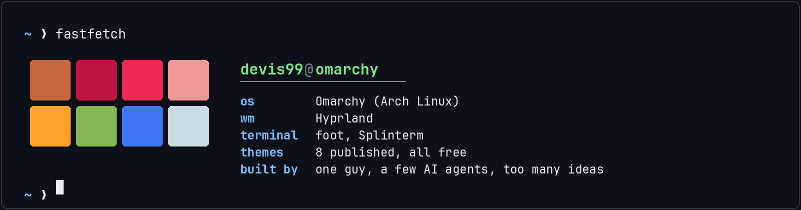
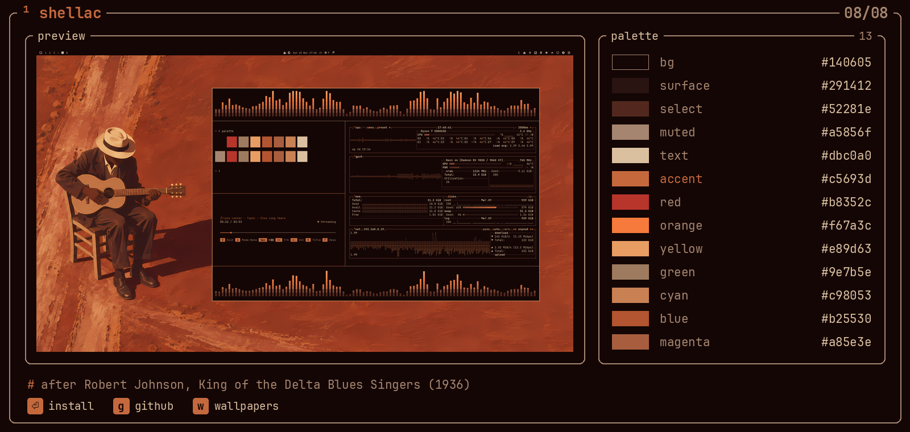
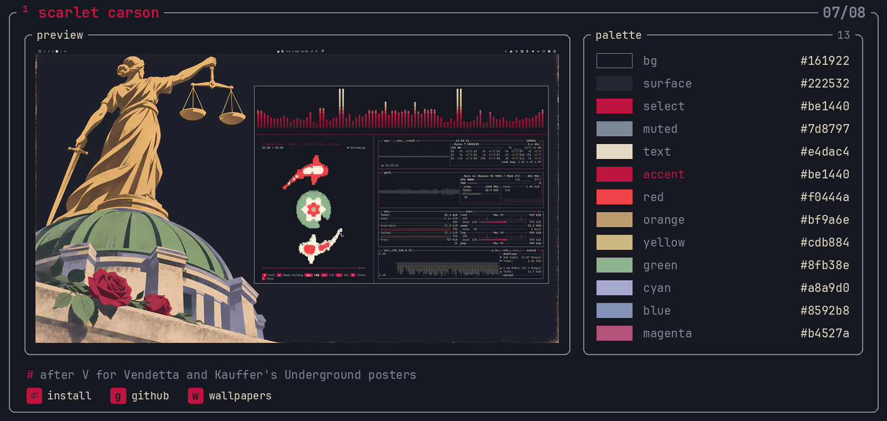
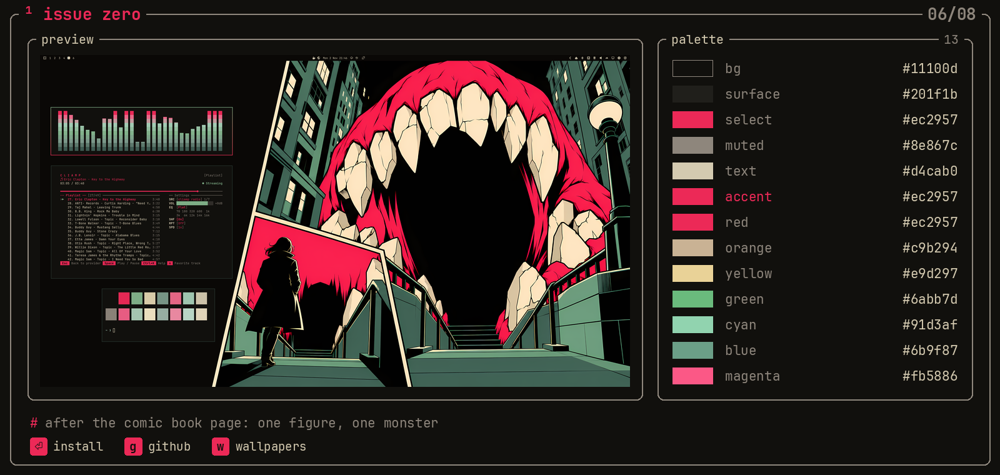
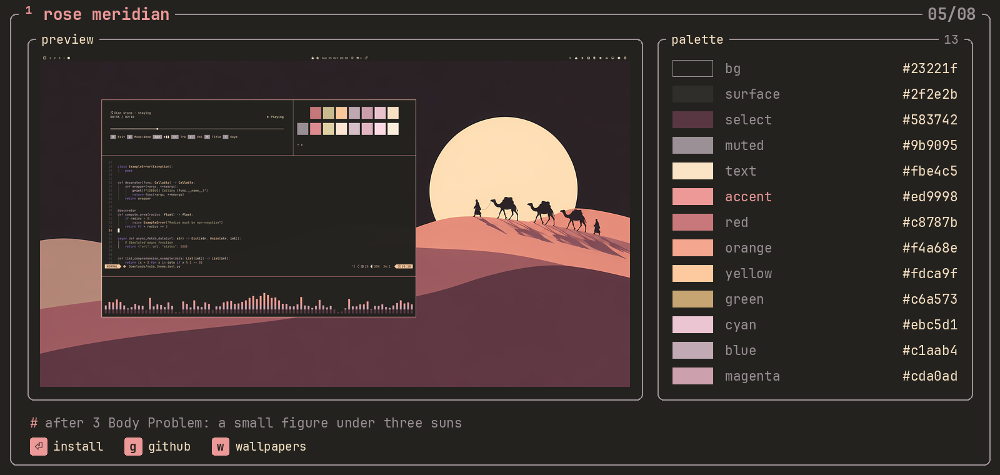
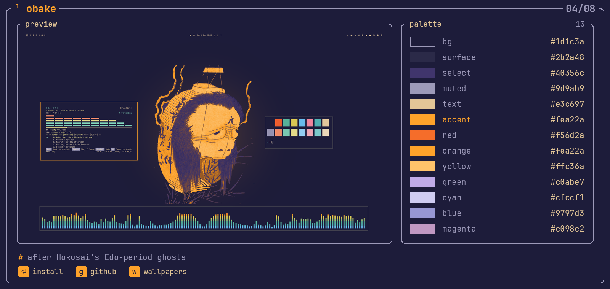
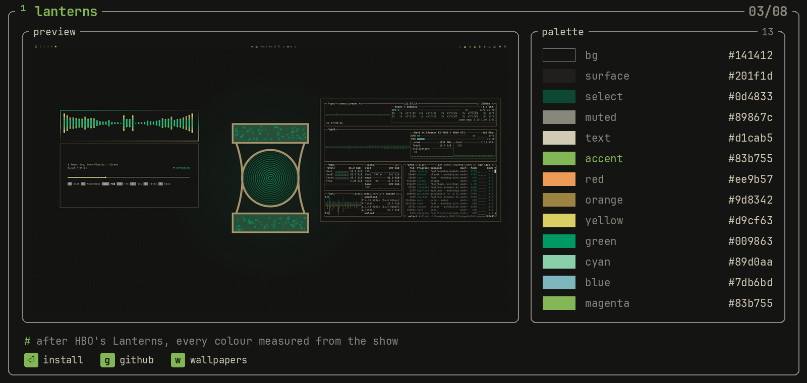
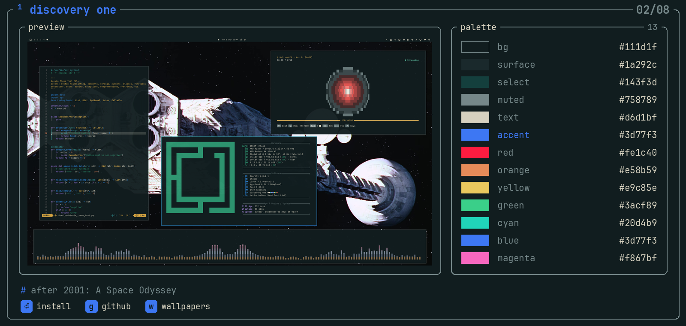
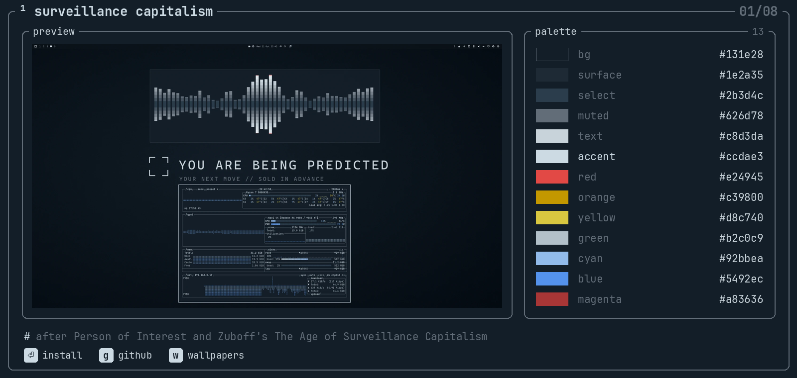

```sh
# install any of them
omarchy theme install https://github.com/Devis99/omarchy-shellac-theme
```

<a href="https://github.com/Devis99/omarchy-shellac-theme"></a>

<a href="https://github.com/Devis99/omarchy-scarlet-carson-theme"></a>

<a href="https://github.com/Devis99/omarchy-issue-zero-theme"></a>

<a href="https://github.com/Devis99/omarchy-rose-meridian-theme"></a>

<a href="https://github.com/Devis99/omarchy-obake-theme"></a>

<a href="https://github.com/Devis99/omarchy-lanterns-theme"></a>

<a href="https://github.com/Devis99/omarchy-discovery-one-theme"></a>

<a href="https://github.com/Devis99/omarchy-surveillance-capitalism-theme"></a>
